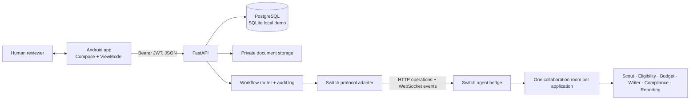

# GRANTBRIDGE

GRANTBRIDGE is a human-led grant application workspace for nonprofits. A native Android app connects to a FastAPI service that stores organization and application data, manages evidence and approvals, and coordinates specialist agents through Switch.

The repository contains a demonstrable end-to-end MVP. It is not a live grant marketplace: demo opportunities are explicitly labeled, AI results depend on configured Switch agents, and the organization records an external submission manually. No agent can approve or submit an application.

## What works

- Email and password registration/sign-in, Argon2 password hashes, signed expiring bearer tokens, logout revocation, and organization membership roles.
- Tenant-scoped organization, grant, application, document, and notification APIs. Organization roles are owner, admin, member, and read-only viewer.
- Organization profile completion and editing; invite existing accounts to an organization and set their role.
- Search and sector filtering for grants, HTTPS source import, grant requirements, and a clearly labeled sample opportunity.
- Application creation, eligibility assessments with evidence and missing requirements, private document upload and text extraction, human-editable budget and application sections, compliance issues, reminders, tracking, audit history, and digest-bound human approval.
- Switch room creation and targeted agent handoffs through the documented Switch agent bridge protocol. The app displays when Switch is unavailable and does not claim a Switch handoff occurred.
- Android Compose screens for account access, onboarding, dashboard, grant search and import, and a five-tab bottom bar with bundled SVG icons. Tapping a funding card opens a report with the Grant Scout avatar, fund facts, listed requirements, and an application pathway diagram. The avatar uses the exact Originkit Cosmic Orb and Cobalt Sprite component sources inside a local Android WebView asset bundle; Cobalt Sprite is used as the AI agent avatar throughout reports and team views. The Vite project in `android/cosmic-orb` builds the avatar bundle into Android assets; it is not a standalone product website. Application details open nested Overview, Eligibility, Budget, Draft, Compliance, and Activity pages. The Team tab shows organization members and AI specialists with a shared, refreshing team message room. The document center supports search, filters, upload categories, application selection, extraction status, and an evidence checklist. Profile has separate Personal details, Organization, Team, and Settings pages. Appearance and preferred language settings persist on-device; the language list includes English, Hindi, Bengali, Spanish, French, Arabic, Mandarin Chinese, Portuguese, Swahili, Tamil, Japanese, and Russian. Workspace connection failures have a branded retry screen, and network work shows an animated loading indicator. Session tokens are encrypted with an Android Keystore AES-GCM key and stored in app-private DataStore.

## Architecture



One Switch room is created for each grant application. GRANTBRIDGE persists application stages, structured assessments, agent messages, evidence provenance, compliance issues, human decisions, and approvals in its database. Switch carries agent-to-agent work and room history. A final approval records a digest of the draft; later edits supersede that approval. The app does not call a grantor or submit externally.

## Run the backend locally

Requirements: Python 3.11 or newer.

```powershell
cd backend
python -m venv .venv
.venv\Scripts\Activate.ps1
pip install -r requirements-dev.txt
Copy-Item .env.example .env
```

Edit `backend/.env` and set `AUTH_SECRET` to a random value of at least 32 bytes. For an isolated local demo, the SQLite default is fine. Apply migrations and start the service:

```powershell
alembic upgrade head
uvicorn app.main:app --reload
```

The interactive API reference is at `http://127.0.0.1:8000/docs`; health is at `/health`. The first user registers at `/v1/auth/register`, then creates an organization. The Android onboarding uses these same APIs.

## Run the Android app

Requirements: Android Studio, JDK 17, Android SDK 35, and an emulator or device.

Open the `android/` folder in Android Studio and run the `app` configuration. The emulator default API address is `http://10.0.2.2:8000/`. For a different backend, configure the Gradle property `grantbridgeApiBaseUrl`, or set `GRANTBRIDGE_API_BASE_URL` in the Android build environment. Use HTTPS for a physical device or any non-local deployment. Keep Switch and model credentials on the backend.

## Download an APK from GitHub Actions

The `Build and publish Android APK` workflow builds on pull requests and pushes to `main`. Run it manually from the Actions tab to publish an `app-debug.apk` artifact, available for 30 days. It rebuilds the bundled avatar assets before assembling the Android app.

## Enable Switch

Set `SWITCH_BASE_URL`, `SWITCH_AGENT_ID`, `SWITCH_AGENT_API_KEY`, and the exact registered participant names in `backend/.env`. Register a dedicated coordinator agent and the specialist agents in the same Switch workspace. The adapter uses the Switch agent protocol for room creation, participant connection, targeted messages, and the coordinator WebSocket event stream. Agent/model provider configuration and key delivery are managed in Switch; GRANTBRIDGE does not bundle a model provider.

When Switch is not configured, GRANTBRIDGE keeps the demo workflow usable but marks collaboration unavailable. This local fallback is for UI and review only; do not present it as a live multi-agent run. The protocol is version-sensitive, so validate operations and event frames against the deployed Switch version when upgrading.

## Docker Compose

Copy `backend/.env.example` to `backend/.env`, set a strong `AUTH_SECRET`, and set `POSTGRES_PASSWORD` in the environment. Then run from the repository root:

```powershell
docker compose up --build
```

The API listens on port 8000. Compose stores uploaded files in a private Docker volume. The default Compose password is only for a local machine; replace it before sharing the deployment.

## Test the workflow

From `backend/` with the virtual environment active:

```powershell
python -m pytest tests -q
python -m compileall -q app migrations
alembic upgrade head
```

The integration test registers two accounts, checks tenant isolation, creates an organization and sample grant, uploads private evidence, drives the eligibility/budget/writing/compliance flow, exercises the Switch handoff adapter with a test double, verifies approval invalidation after edits, records manual submission and tracking, and checks logout revocation. The Switch test double does not establish a live Switch connection.

## Demo path

1. Register a new user in the Android app and create an organization.
2. Open Discover and choose the opportunity marked `SAMPLE`.
3. Open the application workspace. Review the eligibility findings and upload the requested registration evidence.
4. Review and human-approve the proposed budget, edit the application sections, and inspect compliance findings.
5. Request a revision from the assigned reviewer/writer through Switch when configured; verify each correction and resolve the issue.
6. Approve the final draft. The approval is tied to its content digest.
7. After submitting through the grantor's own process, record submission in GRANTBRIDGE and later record award or rejection and reporting requirements.

## Trust boundaries and known limits

- Live grant discovery, grantor integrations, push notifications, password reset, and production identity federation are not implemented. Grant search covers saved opportunities and the labeled sample dataset.
- The Android app has not been compiled in the current workspace because JDK, Gradle, and Android SDK tooling are unavailable here. Run it in Android Studio before release.
- Document text extraction is best-effort. Scanned PDFs and images are retained for human review; OCR is not included. Production needs encrypted object storage, malware scanning, retention controls, and stronger operational backups.
- Switch and model access are external services. Keep secrets server-side and use a dedicated GRANTBRIDGE coordinator connection.
- Local development defaults are not a public deployment configuration. Use TLS, managed secrets, a strong `AUTH_SECRET`, PostgreSQL, private encrypted file storage, backups, and operational monitoring before serving real organizations.
- The Android app does not silently refresh tokens; when a token expires, users must sign in again.

## Reference material

- [Switch source repository](https://github.com/sandbox-quantum/switch)
- [Switch agent protocol](https://docs.switchagents.ai/switch-rooms/internals/agent-protocol)
- [Switch documentation MCP](https://docs.switchagents.ai/mcp) (documentation retrieval, not runtime transport)
